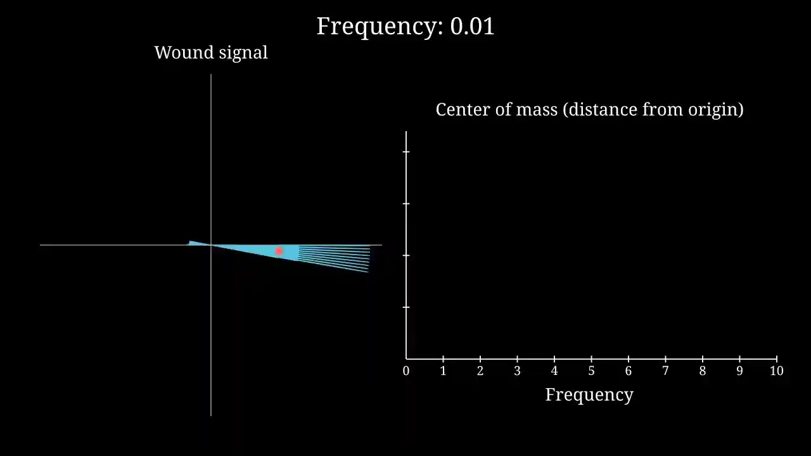

# Fourier Transform Visualizer



## Setup
```
# Environment created on linux (fedora 43)
conda env create --file environment.yml
conda activate manim
```

## Usage
```
python main.py -f <frequency values>
```